# Taller Individual Nro. 1
## Primeros pasos en programación funcional

**Estudiante**: Adrián Guamám
**Semana**: 1
**Entorno**: GitHub Codespaces

---

## Primera parte: instalación de herramientas

### 1. Java 25

Listé las versiones disponibles con:

```shell
sdk list java
```

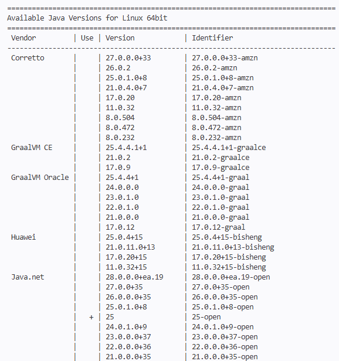

Instalé la versión con identificador `25-open`:

```shell
sdk install java 25-open
```

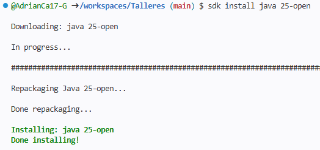

Verificación:

```shell
java -version
```

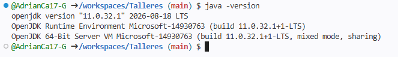

### 2. sbt

```shell
sdk list sbt
sdk install sbt
sbt --version
```

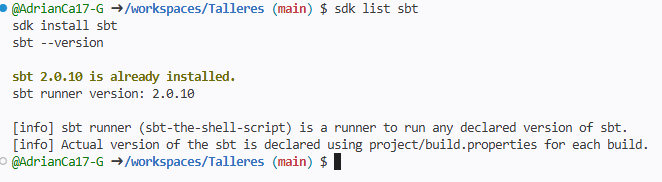

### 3. Scala CLI

```shell
sdk list scalacli
sdk install scalacli
scala-cli --version
```

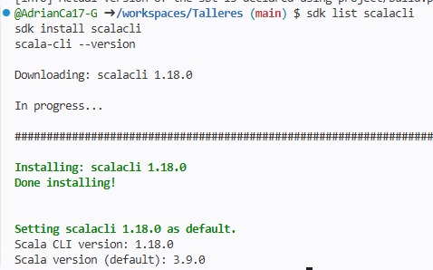

### 4. Verificación general

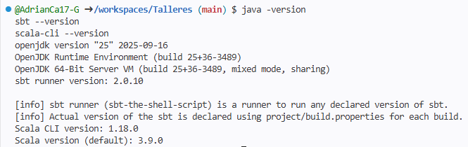

---

## Segunda parte: REPL de Java, Scala y Python

Abrí tres terminales y ejecuté en cada una:

| Lenguaje | Comando |
|----------|---------|
| Java     | `jshell` |
| Scala    | `scala` |
| Python   | `ipython` |

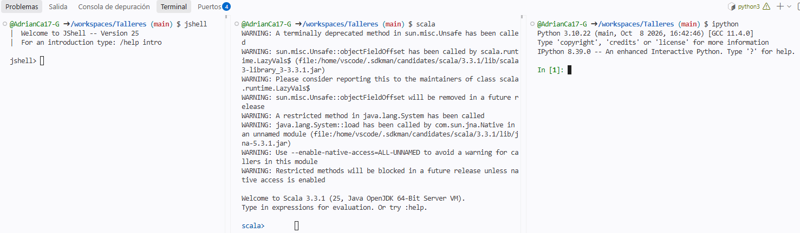

### Java (jshell)

```java
var nums = List.of(1, 2, 3, 4, 5);
nums.stream().map(n -> n * 10).toList()
record Tuple(int x, int y){}
nums.stream().map(n -> new Tuple(n, n * n)).toList()
nums.stream().filter(n -> n % 2 == 0).toList()
nums.stream().reduce(1, (n1, n2) -> n1 * n2)
```

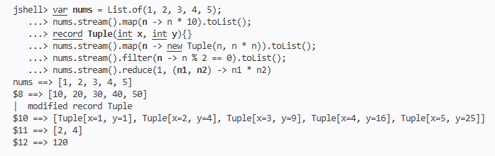

### Scala (scala)

```scala
val nums = List(1, 2, 3, 4, 5)
nums.map(_ * 10)
nums.map(n => (n, n * n))
nums.filter(n => n % 2 == 0)
nums.reduce((n1, n2) => n1 * n2)
```

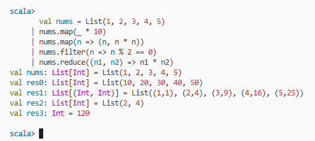

### Python (ipython)

```python
lst = [1, 2, 3, 4, 5]
list(map(lambda n: n * 10, lst))
list(map(lambda n: (n, n * n), lst))
list(filter(lambda n : n % 2 == 0, lst))
from functools import reduce
reduce(lambda x, y : x * y, lst, 1)
```

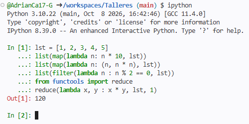

### Resultados obtenidos

| Operación | Resultado |
|-----------|-----------|
| Mapear (x 10) | _tu resultado aquí_ |
| Mapear (tupla con cuadrado) | _tu resultado aquí_ |
| Filtrar pares | _tu resultado aquí_ |
| Reducir (producto) | _tu resultado aquí_ |

### ¿Cuál tiene la sintaxis más fácil de comprender?


---

## Ejercicio final

### Parte 1: de Java a Scala

Código original (Java, imperativo):

```java
double getAverage(List<Integer> nums) {
	var sum = 0;
	for(var num : nums) {
		sum += num;
	}
	return sum / (double)nums.size();
}
```

Mi traducción a Scala 3:

```scala
// _tu traducción aquí_
```

Prueba en `scala-cli repl`:

```scala
// _tu llamada de prueba aquí, por ejemplo con List(1, 2, 3, 4, 5)_
```

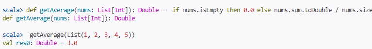

### Parte 2: versión funcional con ChatGPT

**Prompt utilizado:**

```text

```

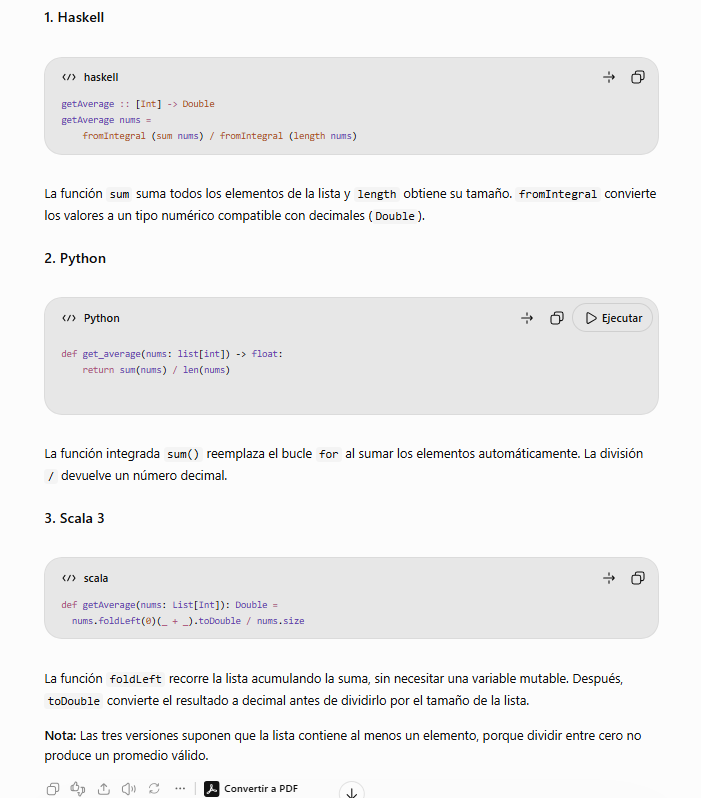

**Haskell:**

```haskell
-- _código obtenido_
```

**Python:**

```python
# _código obtenido_
```

**Scala 3:**

```scala
// _código obtenido_
```

**Prueba en Scala CLI (`scala-cli repl`):**

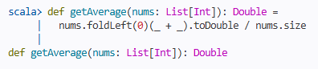

### Comparación (imperativo vs. funcional)


---

## Preguntas para la defensa

Ten claras estas respuestas:

- ¿Qué hace `map`, `filter` y `reduce`? Explica cada uno con un ejemplo de la lista `[1, 2, 3, 4, 5]`.
- ¿Qué es una función lambda y cómo se escribe en cada lenguaje?
- ¿Por qué Java necesita un `record` para la tupla y Scala/Python no?
- ¿Qué diferencia hay entre la versión imperativa y la funcional de `getAverage`?
- ¿Para qué sirve SDKMAN?

---

## Calificación

- 10 puntos si se presenta en el horario de prácticas y experimentación.
- 7 puntos si se presenta en el horario de tutoría.
