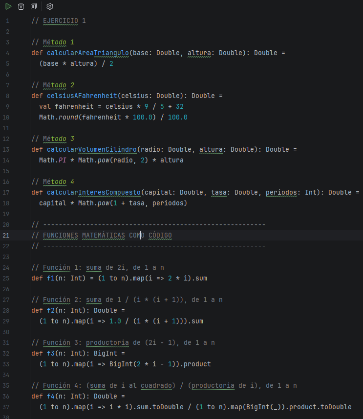

# Taller Individual 2 - Versión 5
## Funciones, funciones matemáticas como código

**Estudiante**: Adrián Guamán
**Semana**: 2
**Entorno**: GitHub Codespaces

---

## Worksheet

Creé el archivo `taller2.sc` (worksheet) con todo el código del taller y lo ejecuté con:

```shell
scala-cli taller2.sc
```




---

## Ejercicio 1: de métodos Java a funciones Scala

### Método 1: calcularAreaTriangulo

```java
double calcularAreaTriangulo(double base, double altura)  {
   double area = (base * altura) / 2;
   return area;
}
```

```scala
def calcularAreaTriangulo(base: Double, altura: Double): Double =
  (base * altura) / 2
```

### Método 2: celsiusAFahrenheit

```java
double celsiusAFahrenheit(double celsius) {
	double fahrenheit = celsius * 9 / 5 + 32;
	fahrenheit = Math.round(fahrenheit * 100.0) / 100.0;
	return fahrenheit;
}
```

```scala
def celsiusAFahrenheit(celsius: Double): Double =
  val fahrenheit = celsius * 9 / 5 + 32
  Math.round(fahrenheit * 100.0) / 100.0
```

### Método 3: calcularVolumenCilindro

```java
double calcularVolumenCilindro(double radio, double altura) {
	double volumen = Math.PI * Math.pow(radio, 2) * altura;
	return volumen;
}
```

```scala
def calcularVolumenCilindro(radio: Double, altura: Double): Double =
  Math.PI * Math.pow(radio, 2) * altura
```

### Método 4: calcularInteresCompuesto

```java
double calcularInteresCompuesto(double capital, double tasa, int periodos) {
    double monto = capital * Math.pow(1 + tasa, periodos);
    return monto;
}
```

```scala
def calcularInteresCompuesto(capital: Double, tasa: Double, periodos: Int): Double =
  capital * Math.pow(1 + tasa, periodos)
```

### Resultados del Ejercicio 1

| Llamada | Resultado esperado | Resultado obtenido (RELLENAR) |
|---------|--------------------|-------------------------------|
| `calcularAreaTriangulo(10, 5)` | 25.0 | |
| `celsiusAFahrenheit(100)` | 212.0 | |
| `calcularVolumenCilindro(2, 3)` | aprox. 37.6991 | |
| `calcularInteresCompuesto(1000, 0.05, 2)` | aprox. 1102.5 | |

---

## Funciones matemáticas como código

### Función 1

```math
f(n) = \sum_{i=1}^{n} 2i
```

Tres primeros términos: 2 + 4 + 6

```scala
def f1(n: Int) = (1 to n).map(i => 2 * i).sum
```

### Función 2

```math
f(n) = \sum_{i=1}^{n} \frac{1}{i(i + 1)}
```

Tres primeros términos: 1/2 + 1/6 + 1/12

```scala
def f2(n: Int): Double =
  (1 to n).map(i => 1.0 / (i * (i + 1))).sum
```

### Función 3

```math
f(n) = \prod_{i=1}^{n} (2i - 1)
```

Tres primeros términos: 1 · 3 · 5

```scala
def f3(n: Int): BigInt =
  (1 to n).map(i => BigInt(2 * i - 1)).product
```

### Función 4

```math
f(n) = \frac{\sum_{i=1}^{n} i^2}{\prod_{i=1}^{n} i}
```

Tres primeros términos: (1 + 4 + 9) / (1 · 2 · 3)

```scala
def f4(n: Int): Double =
  (1 to n).map(i => i * i).sum.toDouble / (1 to n).map(BigInt(_)).product.toDouble
```

### Función 5

```math
f(n, a, r) = \sum_{i=1}^{n} a \cdot r^{i}
```

Tres primeros términos: a·r + a·r² + a·r³

```scala
def f5(n: Int, a: Double, r: Double): Double =
  (1 to n).map(i => a * Math.pow(r, i)).sum
```

### Resultados de las funciones

| Llamada | Resultado esperado | Resultado obtenido (RELLENAR) |
|---------|--------------------|-------------------------------|
| `f1(3)` | 12 | |
| `f2(3)` | 0.75 | |
| `f3(4)` | 105 | |
| `f4(3)` | aprox. 2.3333 | |
| `f5(3, 2, 3)` | 78.0 | |

---

## Hoja con los tres primeros términos

Anoté en una hoja cada función con sus tres primeros términos:


---

## Conclusión (RELLENAR con mis palabras)

En Scala las funciones no necesitan `return`, porque el resultado es la última expresión. Para las sumatorias y productorias usé `(1 to n)` para generar los números, `map` para calcular cada término y `sum` o `product` para combinarlos, sin bucles ni variables que cambien. Usé `.toDouble` para evitar la división entera y `BigInt` en las productorias porque crecen muy rápido.
